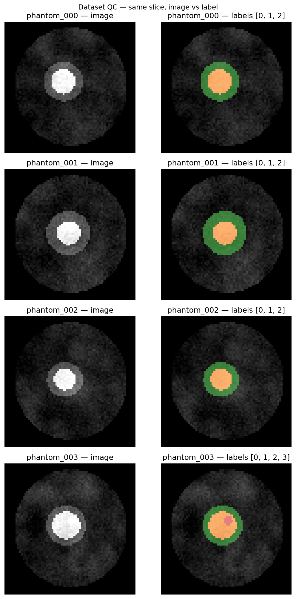

# nnU-Net vs Swin UNETR on 3D medical images — what I learned

[](https://github.com/naveed1011/nnunet-medseg-benchmark/actions/workflows/tests.yml)
[](LICENSE)
[](https://github.com/MIC-DKFZ/nnUNet)

I built this repository to stop *using* nnU-Net and start *understanding* it.

I could already run `nnUNetv2_train` and get a Dice score. What I could not do was explain
why the planner chose a particular patch size, why the spacing was resampled (or not), or
whether a Transformer would have done better if I gave it the same data and the same budget.
So I turned the thing I was learning into a small, controlled experiment — and I kept the
whole thing, including the mistakes, in one place.

> **The question I am chasing:** when a self-configuring CNN (nnU-Net) and a Transformer
> (Swin UNETR) get the same cases, the same split, the same preprocessing and a comparable
> compute budget, which one wins — and do they fail in *different* ways?

This is a learning log, not a leaderboard entry. Where I have numbers, I show them. Where I
have not run something yet, I say so instead of filling the gap with a citation.

---

## Status, honestly

| Phase | What it is | Status | Where |
|---|---|---|---|
| **0a** | Code verification: metrics, converters, XAI, figures, notebook syntax | ✅ 43 tests (6 skip without torch) | [`tests/`](tests) |
| **0b** | Full pipeline on a synthetic phantom | 🟡 planning/preprocessing ran; training stopped on CPU cost | `run_pipeline.py demo` |
| **1** | MSD Task02_Heart, 100-epoch nnU-Net | ⏳ one Kaggle session | `notebooks/01_nnunet_heart_msd.ipynb` |
| **2** | BraTS 2021 subset, nnU-Net arm | ⏳ one Kaggle session | `notebooks/02_nnunet_brats.ipynb` |
| **3** | BraTS 2021 subset, Swin UNETR arm | ⏳ one Kaggle session | `notebooks/03_swinunetr_brats_monai.ipynb` |
| **4** | Comparison table + figures | ⏳ ~5 min after 2 & 3 | `notebooks/04_compare_nnunet_vs_swin.ipynb` |
| **5** | XAI: saliency + GradCAM | ⏳ after 3 | `notebooks/05_xai_analysis.ipynb` |

Everything is built so that phase 4 writes its own results page. I do not hand-copy numbers
into this README — that is how tables and figures start disagreeing.

---

## Why I started with a phantom — and the bug it caught

Before spending GPU hours on BraTS, I wanted to know that *my own code* was right. So I wrote
`scripts/make_demo_data.py`: a synthetic "head" with two MRI-like channels, a tumour core, an
edema ring and a small enhancing blob, saved in the exact nnU-Net v2 folder format.

The first QC picture came out wrong. The tumour was floating off-centre. I had built the
coordinate grid as `(z, y, x)` but paired the `x` array with the `z` spacing, so with my
1.5 mm slice thickness everything was shifted along the wrong axis. Fifteen minutes on
synthetic data, and the bug was obvious in one image.

On BraTS, that same bug would have shown up as a mediocre Dice after a ten-hour Kaggle
session — and I would have blamed the model, or the epoch budget, or the Transformer. I would
have been wrong on all three.

The fixed QC figure is in [`docs/figures/demo_data_qc.png`](docs/figures/demo_data_qc.png):



---

## What I verified — and what I deliberately did not run

I ran the code on this laptop (4 CPU cores, torch CPU-only). Training was the one thing I
stopped: `3d_fullres` needed roughly **9 s per iteration** (patch 56×80×64, batch 2), which is
~40 minutes for a single 250-iteration epoch, and the 2D fallback still had not finished its
first epoch after 11 minutes. That is a hardware boundary, not a bug — but it means **the Dice
numbers will come from Kaggle, not from this laptop**, and I would rather write that down than
invent a table.

What did run:

| Check | Result |
|---|---|
| `pytest -q` — 43 tests | pass |
| Dataset integrity (`--verify_dataset_integrity`) on the phantom | pass |
| Fingerprint → plan → preprocess, 12 cases | pass, 147 s |
| `nnUNetv2_train` launch (3d_fullres and 2d) | started, then stopped on CPU cost |
| `src.metrics` on written NIfTI predictions | pass (unit + folder-level) |
| `src.compare` table + 3 figures + `RESULTS.md` | pass (synthetic arms) |
| `src.xai` saliency + overlay | pass (toy 3D net; nnU-Net path checked against its source) |
| Notebooks: valid JSON, no placeholders, every code cell parses | pass |

This is the part that changed how I work: **the planner is checkable before you train.** The
phantom run printed what nnU-Net decided for a 1 × 1 × 1.5 mm dataset:

| Config | patch | batch | spacing kept |
|---|---|---|---|
| `3d_fullres` | 56 × 80 × 64 | 2 | 1.5 × 1.0 × 1.0 mm |
| `2d` | 80 × 64 | 24 | in-plane 1 mm |

It kept my 1.5 mm slice thickness instead of forcing isotropic — the kind of decision I could
not have explained before reading `nnUNetPlans.json`.

---

## What changed from my first attempt

I built this project twice. The first version ran, in the sense that the commands existed; it
would not have survived a Kaggle session. The second version is what is in this repo.

| First version | What would have happened | What I changed | What I learned |
|---|---|---|---|
| copied the MSD folder into `nnUNet_raw` | `plan_and_preprocess` fails: MSD ships the v1 `modality` key, v2 requires `channel_names` | notebook 01 runs `data/convert_to_nnunet.py` | the dataset folder is a contract, not just a folder |
| converter wrote a `"dataset"` block using `"image"` | `verify_dataset_integrity` crashes on `KeyError: 'images'` | removed the block; nnU-Net discovers files from `imagesTr/` | reading the loader source beat guessing the schema |
| evaluated predictions on all 20 heart cases | Dice looks great and means nothing (16 of them were training cases) | predict and evaluate the held-out fold only | a number is only as honest as its split |
| Swin UNETR validated on random 96³ crops | val Dice depends on where the crop landed | `validate_full()` — sliding window over the whole volume | validation must match inference |
| `pick("nnunet")` to find result folders | it also matches `brats_swinunetr` — the comparison could compare Swin with itself | exact parent-folder match + an assert that the arms differ | substring matching is a bug with a delay |
| bash-only scripts | nothing runs on Windows | `run_pipeline.py` + `doctor` | my own machine is a target platform |
| `.gitignore` had a bare `figures/` | it also ignores `docs/figures/`, so the README images never get pushed | root-scoped ignores + `!docs/figures/` | the repo must be able to show its own results |
| README said "code ready" with no evidence | a reader cannot tell what works | status table, tests, CI, an explicit "not run yet" list | untested claims are the easiest thing to cut |

The short version: **the first version was a pipeline I hoped worked; this one is a pipeline I
can check.** Every item above was found by tests, by the phantom, or by reading nnU-Net's own
source — not by a bigger GPU.

### What actually helped me understand this

- **Building the phantom.** Drawing a tumour forced me to think about spacing, orientation and
  label conventions. The axis bug was visible in one image; on BraTS it would have cost a
  ten-hour session and I would have blamed the model.
- **Computing HD95 by hand for a two-voxel shift.** Writing that unit test taught me more
  about the metric than any paper section.
- **Reading `run_case` and `convert_predicted_logits_to_segmentation_with_correct_shape`.**
  The inverse transform (resample → un-crop → un-transpose) is where saliency maps usually go
  silently wrong; I copied nnU-Net's own order instead of inventing one.
- **Reading `plans.json` after planning.** Patch size, batch size and spacing stop being magic
  numbers once you see them derived from the fingerprint.

---

## The comparison I am actually building

The phantom checks the plumbing; BraTS is the experiment. The protocol is fixed before any
model sees the data, because a comparison that is designed after looking at the scores is not
a comparison.

**Data.** The first 50 cases of BraTS 2021 in sorted order — 40 train / 10 validation, chosen
deterministically (every 5th case is validation). No seed hunting, no reshuffling: anyone can
rebuild the split from `brats_subset_split.json`.

**Labels.** BraTS labels `{0, 1, 2, 4}` become `{0, 1, 2, 3}`. This is not cosmetic: nnU-Net
requires consecutive integers starting at 0. Getting this wrong is the single most common way
to quietly destroy a BraTS run, so the converter rewrites the label volume and the notebook
prints the unique values back.

**Fairness.** Both arms get the same cases, the same held-out volumes and the same metric
code. nnU-Net self-configures its patch size, batch size, spacing and augmentation; Swin
UNETR gets sensible fixed defaults (96³ patches, batch 1, foreground z-score). That is
*budget-matched*, not *tuning-matched* — and I will write it that way.

| Knob | nnU-Net arm | Swin UNETR arm |
|---|---|---|
| Cases / split | first 50, 80/20 fixed | same file, same split |
| Preprocessing | nnU-Net's own (per-channel, resampled) | matched foreground z-score, 1 mm iso |
| Budget | 100 epochs × 250 iters | 100 epochs × 1 pass (≈40 iters) |
| Inference | sliding window + mirroring TTA | sliding window, 96³ ROI |
| Metrics | `src/metrics.py` | same code path |

That budget row is the one I want to be honest about: "100 epochs" means something different
in the two loops. I report it rather than hiding it.

---

## How I evaluate, and the choices I refuse to hide

- **Per-case first.** Every table has a mean, but every figure also shows the distribution.
  With ten validation volumes, one catastrophic case moves the mean more than any architecture
  difference.
- **Dice is undefined when both masks are empty.** I return `nan` and exclude it, instead of
  scoring 1.0 and inflating the average.
- **A missed structure is `inf` HD95, not a dropped row.** The summary reports the percentage
  of infinite cases, so "the model never found the enhancing tumour" cannot hide inside a mean.
- **Validation cases only.** Predicting the training cases and reporting the average would
  look better and mean nothing.
- **No significance test.** At n = 10 I can describe the difference, not claim it is real. If
  the gap is small, I will say it is small.

---

## Run it

```bash
# 1. the check I actually ran before pushing (no GPU, no download, ~30 s)
conda activate learning_env
pip install -r requirements-dev.txt
pytest -q

# 2. optional: exercise the pipeline on synthetic data
#    NOTE: a 3D epoch on CPU takes ~40 min; on a laptop use the 2d config
pip install -r requirements.txt
python run_pipeline.py demo --config 2d

# 3. the real experiments: follow TUTORIAL.md (Kaggle GPU)
```

Step-by-step instructions, including the exact Kaggle settings, the order to run the
notebooks and how to move the results into `docs/results/`, are in
[**TUTORIAL.md**](TUTORIAL.md). The deeper notes are in
[`docs/NNU_NET_PIPELINE.md`](docs/NNU_NET_PIPELINE.md) (what each nnU-Net step does) and
[`docs/KAGGLE_GUIDE.md`](docs/KAGGLE_GUIDE.md) (platform quirks).

---

## Repository map

```
nnunet-medseg-benchmark/
├── run_pipeline.py            # cross-platform driver: doctor / demo / plan / train / predict / evaluate / compare
├── src/
│   ├── metrics.py             # Dice, HD95-mm, volume error, P/R; folder-level evaluator
│   ├── compare.py             # comparison table + 3 figures + auto-written RESULTS.md
│   ├── xai.py                 # gradient saliency for any torch model, and through nnU-Net's own predictor
│   └── figures.py             # prediction-vs-GT-vs-error and dataset QC figures
├── scripts/
│   ├── make_demo_data.py      # synthetic nnU-Net dataset (the smoke test)
│   ├── 01..04_*.sh            # the same pipeline for bash users
├── data/
│   ├── download_msd.py        # MSD Task02_Heart via gdown
│   ├── download_brats.py      # BraTS 2021 via Kaggle API
│   └── convert_to_nnunet.py   # raw -> DatasetXXX_Name (incl. the 4 -> 3 label remap)
├── notebooks/                 # 01 Heart · 02 BraTS nnU-Net · 03 Swin · 04 compare · 05 XAI
├── tests/                     # 43 tests, no GPU, no downloads (CI runs them)
├── docs/
│   ├── NNU_NET_PIPELINE.md    # the five steps, explained for an interview
│   ├── KAGGLE_GUIDE.md        # 12 h sessions, env vars, chaining outputs
│   ├── EXPERIMENT_LOG.md      # what I ran, what broke, what I changed
│   ├── results/               # generated tables + figures (do not hand-edit)
│   └── figures/               # curated figures used in this README
├── tools/gen_notebooks.py     # regenerates the notebooks from one source of truth
└── TUTORIAL.md                # run it, collect results, push
```

---

## What I have not done yet

I want this list to be explicit, because it is the difference between a portfolio project and
a paper:

- **No BraTS numbers yet.** The notebooks are built and syntax-checked, but the GPU runs are
  still queued. I will not invent the table.
- **Single fold, reduced epochs.** No 5-fold CV, no ensemble, no post-processing. These are
  pipeline numbers, not challenge numbers.
- **Swin arm is not tuning-matched.** nnU-Net searches its own configuration; Swin UNETR gets
  fixed defaults. A better-tuned Swin could close part of any gap.
- **Saliency is a sanity check, not evidence.** Input gradients are noisy and first-order. I
  show GradCAM next to them and report where they disagree instead of picking the nicer map.
- **No external test set.** BraTS validation cases are internal; no held-out hospital data.

---

## References

- Isensee, F., et al. *nnU-Net: a self-configuring method for deep learning-based biomedical
  image segmentation.* Nature Methods 18, 203–211 (2021).
- Isensee, F., et al. *Extending nnU-Net is all you need.* arXiv:2404.08244 (2024).
- Hatamizadeh, A., et al. *Swin UNETR: Swin Transformers for Semantic Segmentation of Brain
  Tumors in MRI Images.* MICCAI BrainLes (2021).
- Sudre, C. H., et al. *The Medical Segmentation Decathlon.* arXiv:2106.05735 (2021).
- Baid, U., et al. *The RSNA-ASNR-MICCAI BraTS 2021 Benchmark.* arXiv:2107.02314 (2021).

## License

MIT — see [LICENSE](LICENSE). nnU-Net is Apache-2.0 (DKFZ); MSD is CC-BY-SA 4.0; BraTS data
has its own competition terms.

---

*If you spot a mistake, please open an issue. I would rather fix it here than in a paper.*
